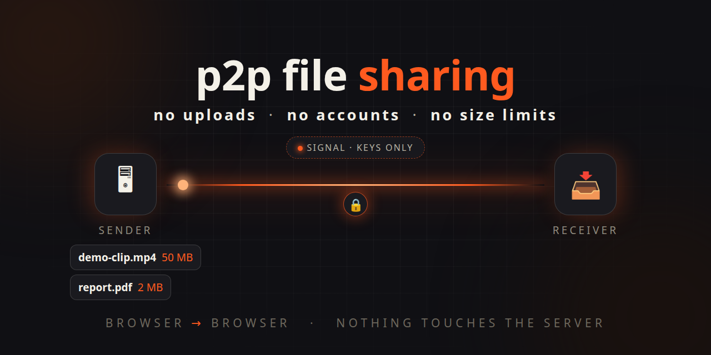

# p2p file sharing



[](LICENSE)
[](signal/go.mod)
[](docs/ARCHITECTURE.md)

P2P file sharing with a signaling server: no uploads, no accounts, no size limits.

Files stream directly between two browsers over encrypted WebRTC — the server
introduces the peers, then gets out of the way. File bytes never touch the server.

<!-- Demo video: embed the YouTube link here after publishing -->

## How it works

Two browsers, one private link. The sender adds files and gets a link with a
short code; the receiver opens it and the files stream directly from sender to
receiver over an encrypted WebRTC connection.

The server only makes the introduction — it passes the connection-setup
messages back and forth and helps the browsers find each other across NATs
(direct when possible, via a TURN relay when necessary). Once the peer-to-peer
channel is open, file bytes flow device to device. Nothing is uploaded, stored,
or proxied: close the sender's tab and there is nothing left to download.

No accounts on either side. No file ever sits on infrastructure you have to trust.

## Try it live

Use it right now, nothing to install:
**[p2pfilesharing.yuktronics.com](https://p2pfilesharing.yuktronics.com)** —
add files, share the link, open it on the receiving device. Both sides stay
online together while the transfer runs.

## Architecture

[](https://p2pfilesharing.yuktronics.com/architecture)

Two planes across two hosts. The **signaling plane** (top) carries only room setup,
presence, and TURN credentials through a Go server behind Caddy. The **data
plane** (green) carries file bytes browser-to-browser and never touches your
infrastructure. Click the diagram to open the interactive version (search,
route tracing, source references).

## Quickstart

Prerequisites: Go 1.25+ and a free port 8090.

```sh
git clone https://github.com/yuktronics/p2p-file-sharing.git
cd p2p-file-sharing/signal
go run ./cmd/signal
```

Open <http://localhost:8090>, add files, and share the link. Open that link in
a second browser (or an incognito window) to receive. `curl http://localhost:8090/healthz`
answers `ok` when the server is up.

## Configuration

All settings are environment variables; invalid values fail fast at startup.
The core set for a first deployment:

| Variable | Default | Meaning |
|---|---|---|
| `SIGNAL_ADDR` | `127.0.0.1:8090` | Listen address |
| `SIGNAL_PUBLIC_BASE_URL` | `http://localhost:8090` | Builds share links |
| `SIGNAL_SITE_URL` | falls back to `SIGNAL_PUBLIC_BASE_URL` | Public frontend origin (canonical, robots, sitemap) |
| `TURN_HOST` / `TURN_SECRET` | unset (relay off) | coturn hostname + shared secret for minted credentials |
| `SIGNAL_ALLOWED_ORIGINS` | loopback origins + `https://*.pages.dev` | CORS allowlist — set to your domain |
| `ADMIN_TOKEN` | unset (admin off) | Bearer token for `/metrics` and admin routes |
| `SIGNAL_DISABLE_UI` | unset (UI served) | Set `1` for an API-only host (pages 404, robots disallows all) |

Full reference, including rate limits, timeouts, and persistence files:
[`docs/CONFIG.md`](docs/CONFIG.md).

## Deployment

Split hosting: a static frontend plus one Go binary.

- **Frontend** — build with `SIGNAL_URL` (backend) and `SITE_URL` (frontend):
  `cd signal/web && SIGNAL_URL=https://api.example.com
  SITE_URL=https://app.example.com node build-pages.mjs`.
  The build fails closed without `SIGNAL_URL`. Deploy `dist/` as Cloudflare
  Workers static assets ([`wrangler.jsonc`](wrangler.jsonc)).
- **Backend** — one Go binary behind Caddy, which terminates TLS
  ([`docs/deploy/Caddyfile`](docs/deploy/Caddyfile); systemd units and the
  coturn config live in [`docs/deploy/`](docs/deploy/)).
- **TURN** — coturn for NAT-traversal fallback
  ([`docs/deploy/turnserver.conf`](docs/deploy/turnserver.conf)).

Step-by-step guides: [`docs/DEPLOY.md`](docs/DEPLOY.md) (split hosting),
[`docs/DEPLOY-VPS.md`](docs/DEPLOY-VPS.md) (VPS walkthrough),
[`docs/DNS-ROUTING.md`](docs/DNS-ROUTING.md) (routing an app + firewall traversal).

## Security

Fail closed by default: TURN credentials, the admin surface, `/metrics`, and
`/debug` are all disabled unless you configure them.

- **Rate limits** (per IP): room creates 10/min, TURN fetches 30/min, abuse
  reports 5/min, nearby-code lookups 20/min — over-limit answers `429` with
  `Retry-After`.
- **Privacy**: no request logs (Caddy discards them), room IDs treated as
  share-link secrets, `no-referrer` throughout. Abuse reports append to
  `REPORT_LOG` (mode `0600`) or stay memory-only.
- **Protocol hardening**: WebSocket frames capped at 32 KB, filename validation
  on REST and WS frames, strict CORS allowlist, short-lived HMAC TURN credentials.

Threat model and the reasoning behind each default:
[`docs/SECURITY.md`](docs/SECURITY.md). To report abuse of a live instance, use
the report flow on the room page.

## Contributing

- **Stdlib only.** A new dependency needs a written justification with
  performance numbers, not vibes.
- **Gates** (from `signal/`): `go vet ./...` clean, `go test ./...` green, and
  `go test -race ./...` — the race detector is mandatory. Client harnesses live
  in `signal/web/tests/`.
- **Wire compat is sacred.** WebSocket frame changes must be backward-compatible
  or bump the protocol version in [`docs/WIRE-PROTOCOL.md`](docs/WIRE-PROTOCOL.md).
- **Docs evolve with code.** Protocol, behavior, or env changes update
  [`docs/CONFIG.md`](docs/CONFIG.md) / [`docs/WIRE-PROTOCOL.md`](docs/WIRE-PROTOCOL.md)
  in the same commit. Small commits, present tense.

## Report a bug / send a PR

Found a bug? [Open an issue](https://github.com/yuktronics/p2p-file-sharing/issues) with:
- what you did, what you expected, what happened instead
- browser + version on **both** sides (sender and receiver)
- anything in the browser console, and whether the TURN relay was in play

PRs welcome — small, present-tense commits with the gates above green. If it
touches a security boundary, say so in the description. Found a server
vulnerability? Don't open a public issue — report it privately via
`/.well-known/security.txt` so details stay secret until a fix ships. (The
in-app report flow is for transfer abuse, not server bugs.)

## License

MIT © 2026 Yuktronics — see [LICENSE](LICENSE).
